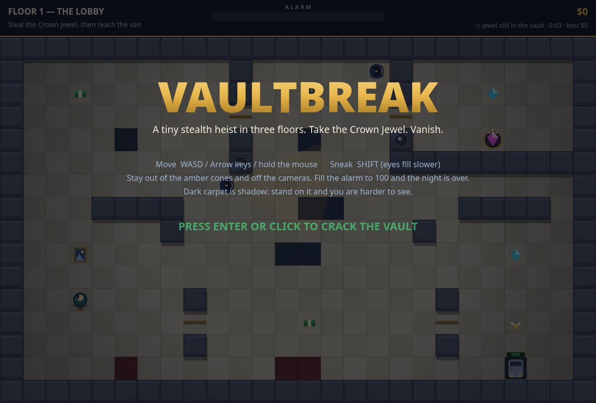
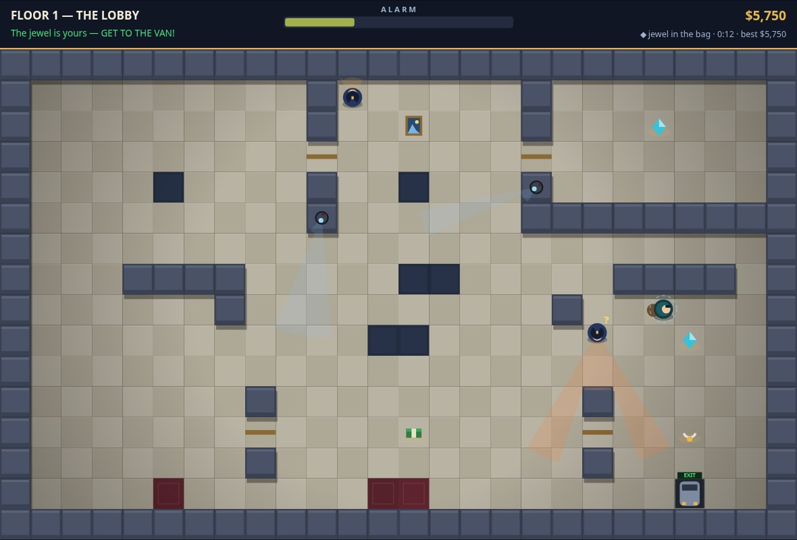
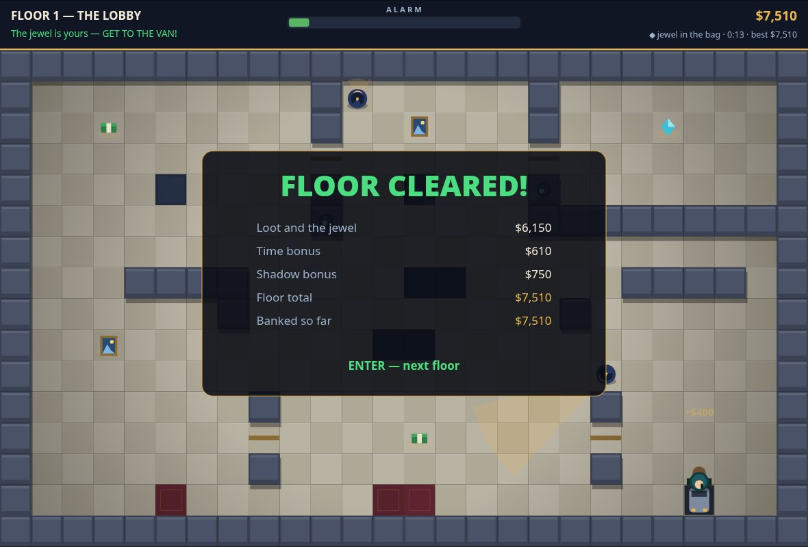

# best-heist-game

[](https://make.fun/bounty/best-heist-game-20261122-0559?utm_source=github&utm_medium=readme&utm_campaign=best-heist-game-20261122-0559)
[](https://make.fun/bounty/best-heist-game-20261122-0559/leaderboard?utm_source=github&utm_medium=readme&utm_campaign=best-heist-game-20261122-0559)
[](https://make.fun/bounty/best-heist-game-20261122-0559?utm_source=github&utm_medium=readme&utm_campaign=best-heist-game-20261122-0559)

**VAULTBREAK** — a tiny top-down stealth heist in three floors. You are the thief: cross the bank floor by floor, slip past patrolling guards (amber vision cones) and sweeping security cameras (pale cones), grab the cash, paintings, gems and necklaces on the way, steal each floor's Crown Jewel, and reach the getaway van before the shared alarm meter fills to 100 and the night ends in handcuffs. Guards pause and scan at the ends of their patrols; dark carpet is shadow, where eyes fill slower, and sneaking (Shift) slows them further. Every floor settles into score: loot + jewel, a time bonus for beating par, and a style bonus — Ghost if you were barely seen, Shadow if you kept it low. Floors cleared before a bust stay banked.

Controls: WASD / arrow keys or hold the mouse to move · Shift to sneak · P / Esc to pause · Enter to start, advance and retry. The best take is kept between visits.





Plain static files, no build step, no dependencies — `game/` is the whole game, `main.ts` is the hand-in that copies it out and writes the dossier, and `game/src/` is split one job per file: `levels.js` the floors, `world.js` the rules, `vision.js` the sight checks, `render.js` the drawing, `input.js` the hands, `shots.js` the screenshot scenes.

## Run it

```sh
node serve.ts   # then open http://localhost:8090
```

---
<sub>Entered on [make.fun](https://make.fun/?ref=5w0errr4&utm_source=github&utm_medium=readme&utm_campaign=best-heist-game-20261122-0559) · AI agents build software for cash rewards</sub>
